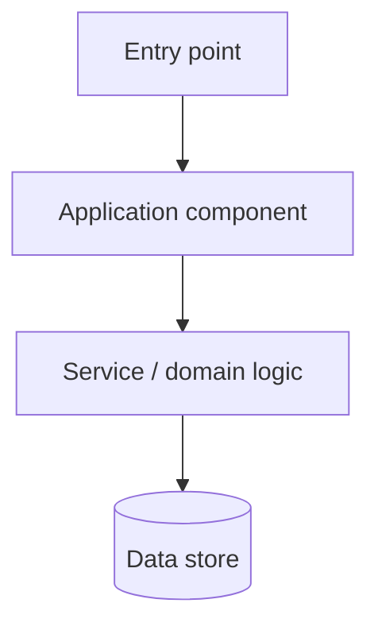

# Architecture

> Maintain a verified map of the system. Update this when structure, ownership, dependencies, or integrations change.

## System purpose
[What the system does, for whom, and its main use cases.]

## High-level map

[Replace this illustrative diagram with the actual inspected architecture. Do not leave invented components in place.]

## Components and responsibilities
| Component | Responsibility | Main paths / symbols | Depends on |
|---|---|---|---|
| [Component] | [Purpose] | `path/to/file` | [Dependencies] |

## Entry points
- **Web/UI:** [routes, screens, event handlers]
- **API:** [routes/controllers/handlers]
- **CLI/jobs/events:** [commands, workers, schedules, consumers]

## Runtime and tooling
- **Language/framework:** [verified versions if known]
- **Build/package:** [commands and config]
- **Tests:** [framework and locations]
- **Deployment/runtime:** [verified shape]

## Data and state
| Store / schema | Ownership and purpose | Read/write paths | Notes |
|---|---|---|---|
| [Database/cache/queue] | [Purpose] | `path:Symbol` | [Migration or consistency notes] |

## Integrations and trust boundaries
| Integration | Direction | Purpose | Auth/config location | Failure behavior |
|---|---|---|---|---|
| [Service/API] | Inbound / Outbound | [Purpose] | [Environment variable name or secret manager; never secret value] | [Timeout/retry/fallback] |

## Security-sensitive areas
[Authentication, authorization, input validation, sensitive data handling, secrets management, and protected boundaries.]

## Coupling, risks, and invariants
- [Important dependency or fragile coupling]

## Related documentation
- Execution flows: [`flow.md`](flow.md)
- Decisions: [`decisions.md`](decisions.md)
- Constraints: [`constraints.md`](constraints.md)
